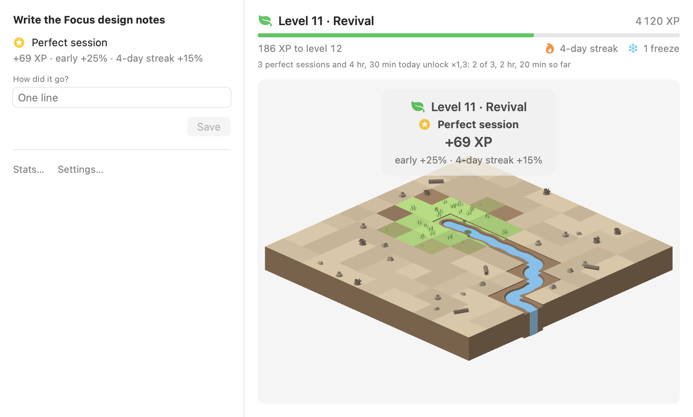
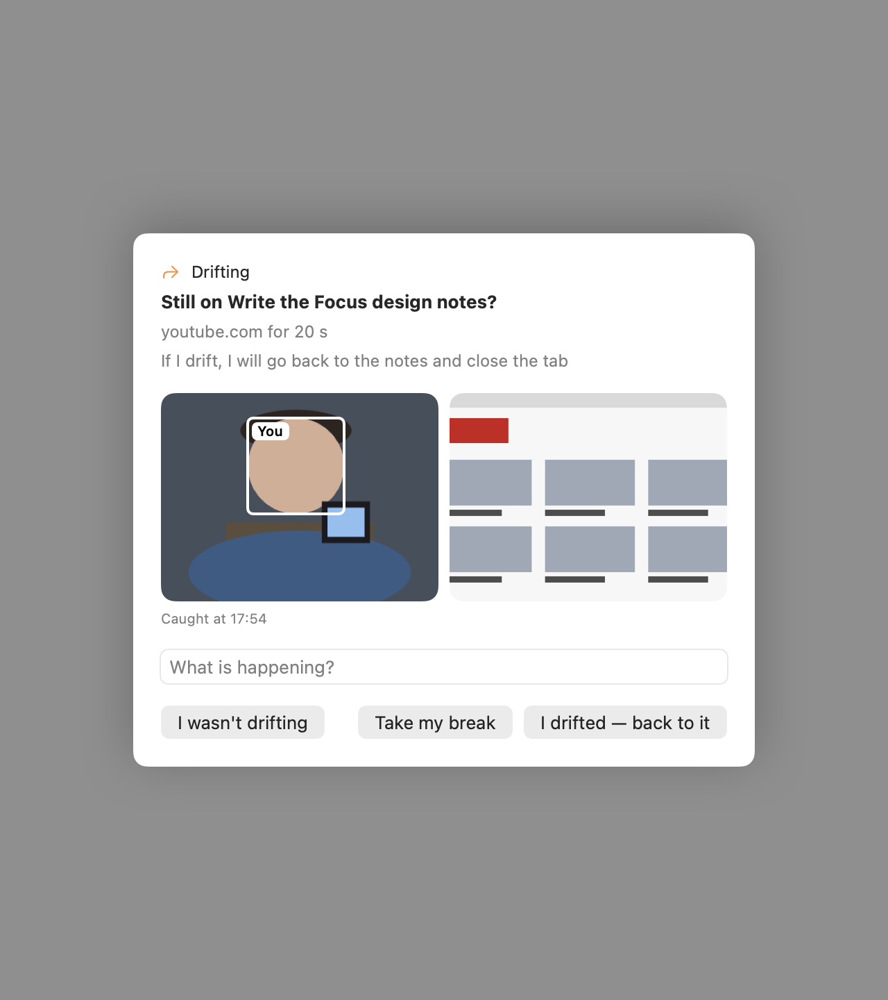
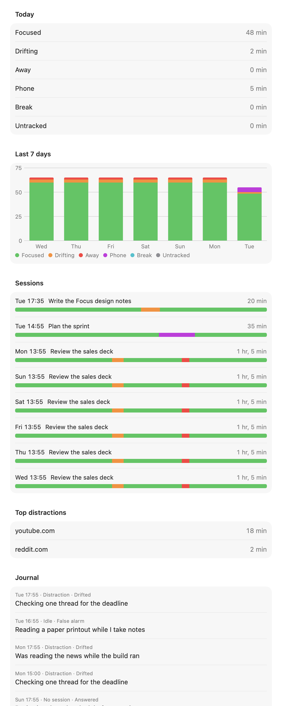
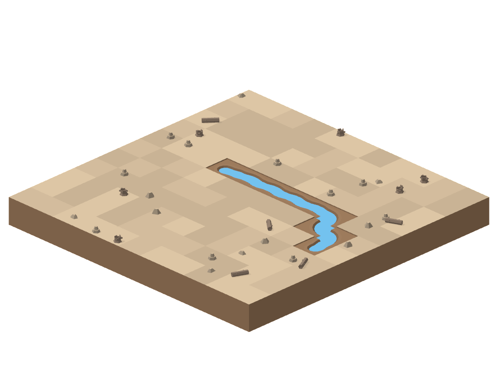
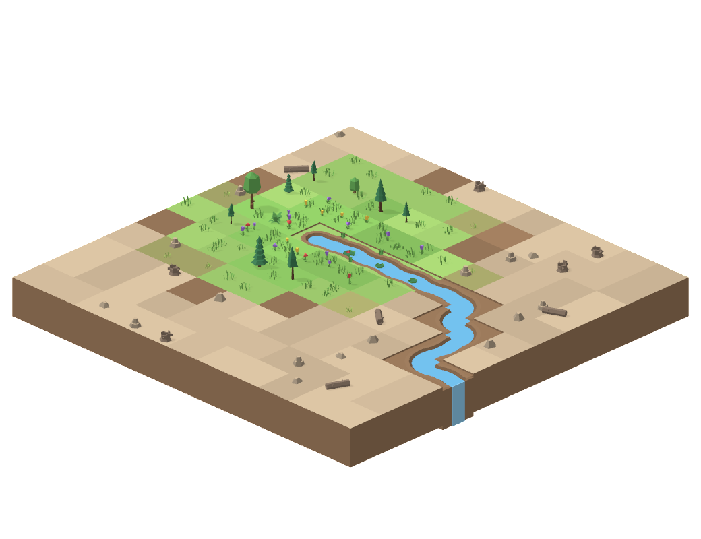
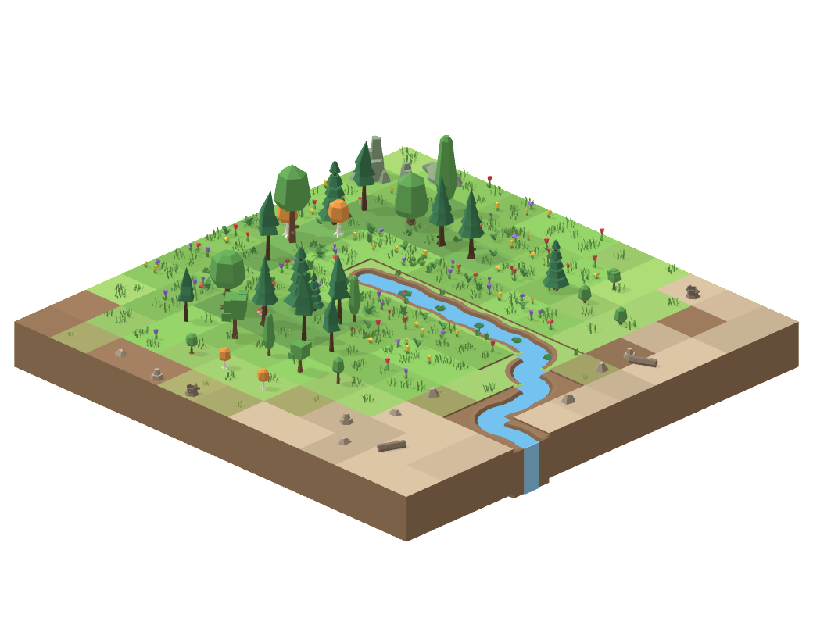
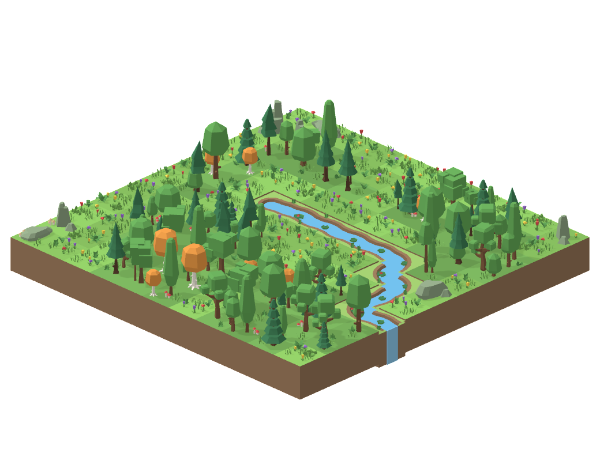

# Focus

A macOS focus app that catches drift within seconds, checks you in, and grows a garden while you work.

<p align="center">
  
  
  <a href="LICENSE"></a>
  <a href="https://github.com/Romain-Jochum/focus/actions/workflows/ci.yml"></a>
</p>

<p align="center">
  <picture>
    <source media="(prefers-color-scheme: dark)" srcset="docs/assets/window-dark.png">
    
  </picture>
</p>

Focus keeps you on the task you declared. During a session it watches the frontmost app and browser tab, the built-in camera (are you there, is your head down, is a phone in frame) and your iPhone's own Bluetooth signal (is it unlocked and in use). When you drift, it covers the screen with a check-in that needs a typed answer, then sounds an alarm if you ignore it. Every second of a session is counted as focused, drifting, away, phone, break or untracked, so focus time is measurable.

Everything runs on the Mac: no account, no network at run time, and camera frames and screenshots never touch the disk unless you turn on developer mode.

## How it works

- **Sensors:** the frontmost app and browser tab, the built-in camera (a face, head pitch, a phone in view), keyboard and mouse input, your iPhone's Bluetooth signal, and whether an app is using the microphone.
- **Check-in:** when you drift, the screen is covered by a card that shows what triggered it and needs a typed answer of at least three words. If it was a false alarm, say so: it costs nothing.
- **Alarm:** a check-in left unanswered for 30 seconds becomes a looping alarm, and a distracting browser tab is closed or app is hidden.
- **Measured time:** every second of a session is counted as focused, drifting, away, phone, break or untracked.
- **Garden:** a perfect session grows an island; drifting costs some XP, and the growth can wither.

<table>
  <tr>
    <td align="center"><br><sub>A check-in: what triggered it, and a typed answer</sub></td>
    <td align="center"><br><sub>Stats: every second counted</sub></td>
  </tr>
</table>

## The garden

A perfect session (completed, planned for at least 25 minutes, no check-in, at least 95% focused) earns XP, with bonuses for early and late starts, streaks and long days; drifting or ending early costs some. XP grows an island over 100 levels, roughly a year of steady work. The water reaches the island's edge during level 4, and the land only starts to green after that.

<table>
  <tr>
    <td align="center"><br><sub>Level 4</sub></td>
    <td align="center"><br><sub>Level 25</sub></td>
    <td align="center"><br><sub>Level 60</sub></td>
    <td align="center"><br><sub>Level 100</sub></td>
  </tr>
</table>

## Requirements

- macOS 26 on Apple silicon, with a built-in camera
- Swift 6 (Xcode or the Command Line Tools)
- [uv](https://docs.astral.sh/uv/), once, to export the phone model
- Network access, once, for the phone model export
- Optional: an iPhone, for the Bluetooth phone signal

## Install

```sh
git clone https://github.com/Romain-Jochum/focus.git && cd focus
make install
```

On the first run this creates a local code-signing identity, so permissions survive rebuilds (macOS may ask for your login keychain password), and exports the phone model: uv downloads Python, PyTorch and RF-DETR into its cache (a few hundred MB, a few minutes). It then builds a release bundle, copies it to `~/Applications/Focus.app` and opens it. Later runs only rebuild. `make uninstall` removes the app; your data stays in `~/Library/Application Support/Focus`.

Focus runs only while it is open: there is no background helper or login item.

### First run

The Focus window lists what is missing; each item opens its page in System Settings.

| Item | Used for |
|---|---|
| Camera | Presence, head pose, phone in frame |
| Accessibility | Window titles |
| Automation (Safari, Chrome) | The current tab's address, closing a distracting tab, hiding YouTube recommendations |
| Screen Recording | The screen thumbnail shown on a check-in |
| Your iPhone (Bluetooth) | Whether your iPhone is unlocked and in use. Click it, then unlock the iPhone next to the Mac; Focus remembers it and ignores other phones |

For YouTube, also turn on "Allow JavaScript from Apple Events" once in Safari's Develop menu and in Chrome's View › Developer menu.

## Using it

- **Start a session:** a one-sentence task, a mode (On computer, Offline or both), a duration, and optionally what you will do if you drift.
- **Check-ins:**
  - **Distraction:** a distracting site or app for 20 s.
  - **Phone:** a phone in the camera's view, or your iPhone reporting use for 15 s, with no keyboard or mouse input for 10 s; or, in On computer mode only, your head down for 45 s with no input (a microphone in use counts as input).
  - **Away:** no face and no keyboard or mouse input for 30 s, or 2 minutes while an app is using the microphone; a covered camera for 30 s (counted from your last input if you cover it while typing, since the camera rests then).
  - **Idle:** in On computer mode only, your face in view and no input for 3 minutes (a microphone in use counts as input).
  - **Offline mode:** using the computer during an Offline-only session.
  - **No session:** working hours without a session running.
- **Answering:** at least three words, then **I wasn't drifting** (a false alarm: the time counts as focused, the card does not count against a perfect session, and that check stays quiet for 10 minutes; a site or app is allowed for 10 minutes), **Take my break** when a break is earned, or **I drifted — back to it**.
- **Away card:** after you are back, it waits for **I was here** (a false alarm) or **I was away**. Its alarm stops when you are back and sounds again after 30 seconds if it is still unanswered.
- **Ignoring a check-in:** after 30 s it becomes a looping alarm (the volume goes up to at least 50% while it sounds, then back), and a distracting tab is closed.
- **Breaks:** one 5-minute break is earned per 50 focused minutes. **Quick pause** is for a short trip away (up to 5 minutes, once per session, twice from 90 minutes) and keeps the earned break; it ends by itself when the camera sees you back after at least 20 s away. Both pause the session timer while the break timer counts down. **I'm back** ends either early.
- **The garden:** the Focus window shows it on the right, with the level, XP, streak and today's multiplier. After a session the new growth spreads in with a card showing the result, and butterflies and birds move over the island for 20 seconds when you open the window.
- **Finishing:** a completed session posts a notification with its result and a sound.
- **Ending early:** type `I am ending this session early`, then wait 10 s (the popover can be closed). While a session runs, Quit is refused.
- **Stats:** today and the last 7 days per category, a timeline per session, top distractions, and every answer.
- **Settings:** working hours, distracting domains and apps, your iPhone, and developer mode.
- **Developer mode** (Settings › Developer, off by default): each check-in you mark as a false alarm is saved with the images it showed (the camera frame, and the screen for site, app, idle and offline cards) and the sensor log of the 3 minutes before it, so you can work on detection with real misses. **Show saved** opens the folder.

## Privacy

- **Stays on the Mac:** nothing leaves it.
- **Stored on disk:** `~/Library/Application Support/Focus`, which holds `settings.json`, `sessions/*.json`, `journal.jsonl`, the compiled model, the garden picture (`garden.png`, `garden.json`) and, in developer mode only, `false-alarms/`.
- **Kept in memory only** (outside developer mode): camera frames (the latest one, and the last one with a phone in it, for the check-in card; dropped when the session ends) and the screen thumbnail (only while a check-in is shown).
- **Developer mode:** off by default. When on, each check-in you mark as a false alarm is written to `false-alarms/<date>-<time>-<reason>/`: `camera.jpg` (the camera frame), `screen.jpg` (the screen thumbnail, for site, app, idle and offline cards) and `alarm.json` (your answer and the sensor log of the 3 minutes before, including app names, window titles and URLs). Nothing is sent anywhere or deleted automatically.
- **The camera:** it runs only during a session, and rests (its light goes off) after 30 s of steady typing unless a check-in is up, on a break (not a quick pause) and while the screen is locked.
- **The iPhone:** Focus reads the advert your iPhone already broadcasts. Nothing is paired, and nothing is installed on the phone.
- **The microphone:** Focus only asks macOS whether some app is using it. No audio is read, and no permission is needed.

## Development

```sh
make test        # engine, rules, store, progression and garden checks (the suite itself runs in about 0.1 s)
make snapshots   # every view in light and dark, the garden at several levels and its animation frames, as PNGs in .build/snapshots
make probe       # live sensor readout plus the CPU and memory budget check
make garden      # the garden alone with a level slider: each level as it appears after a session (nothing is saved)
make clean       # remove build output (the exported model is kept)
```

The budget during a session is at most 3% CPU and under 200 MB. `make probe` keeps the camera streaming throughout, the worst case, and reads 1.2–1.7% CPU and 19–36 MB; in a session the camera also rests while you type (details in [docs/design.md](docs/design.md#camera-cadence-and-budget)).

| Path | Contents |
|---|---|
| `Sources/FocusCore` | The session engine, a pure state machine (`step(Tick) -> [Action]`), plus detection rules, storage, progression (verdicts, XP, streaks, levels) and the garden's island and growth sequence. Foundation only, fully tested. |
| `Sources/Focus` | The app: sensors (activity, camera, iPhone, screen), `AppModel` running the 1 Hz tick, the UI, the garden (SceneKit renderer run in a child process, Core Animation stage), the alarm and sounds, and the `--probe`, `--snapshots` and `--garden-demo` tools |
| `Tests/FocusTests` | An executable test runner: scripted tick timelines fed to the engine |
| `Resources` | `Info.plist`, the icon and the garden's models (`Garden/`, Kenney Nature Kit, CC0); the phone model is generated |
| `scripts` | Signing identity, model export, icon drawing |
| `docs/design.md` | Behaviour, every threshold, architecture and budget |
| `docs/assets` | README screenshots, from `make snapshots` |
| `research/` | The studies and spikes behind the numbers |

The bundle identifier `com.rj.focus` (`Resources/Info.plist` and the Makefile) is what macOS keys permissions on; a fork that ships its own build should change it in both places.

`docs/design.md` is the source of truth for behaviour and every threshold; `research/` holds the studies and spikes behind the numbers.

The app binary also takes these flags: `--probe [--interval s] [--seconds s]`, `--snapshots <dir>`, `--garden-demo [seconds]` (the Focus window replaying the garden's reveal and life, then its CPU and memory; nothing is saved), `--garden-preview` (the garden alone with a level slider; nothing is saved), and `--start "<task>" [minutes]`, which starts a session on launch. `--render-garden <steps> <dir>` is internal: the app runs itself with it to draw the garden.

## Contributing

Issues and suggestions are welcome; see [CONTRIBUTING.md](CONTRIBUTING.md) before opening a pull request, and [SECURITY.md](SECURITY.md) to report a vulnerability privately.

## Credits

- Garden models: [Kenney Nature Kit 2.1](https://kenney.nl), CC0, in `Resources/Garden`.
- Phone detector: [RF-DETR nano](https://github.com/roboflow/rf-detr) by Roboflow, Apache-2.0, with weights pretrained on COCO. It is exported locally by `scripts/make-model.sh` and never committed. A bundle you build includes it, so keep its Apache-2.0 notice if you redistribute one.
- The garden's idea comes from Terra Nil by Free Lives. Its assets are not used.

## License

MIT, see [LICENSE](LICENSE).
